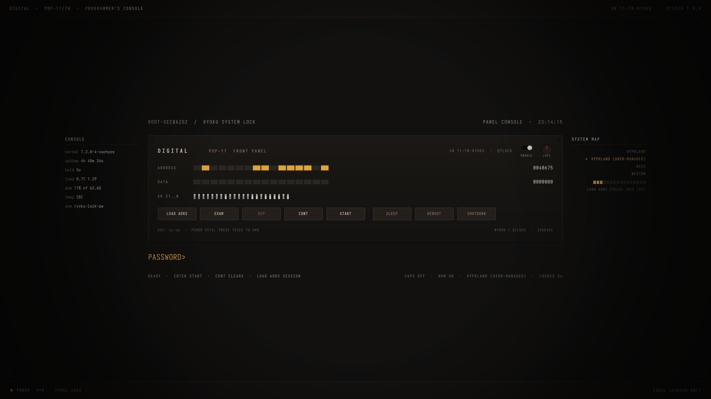
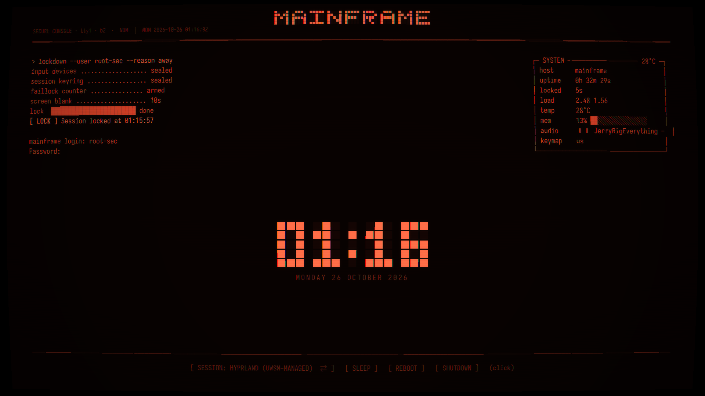

# Ryoku lockscreen packages

Store packages for `qylock` lockscreens on Ryoku. One folder per skin, plus the
index the store reads. Nothing here is terminal-specific: any lock skin added
later follows the same layout.

## Packages in this repository

| id | version | summary |
|---|---|---|
| `pdp11-panel` | 1.0.1 | PDP-11/70 front panel: lamp rows, switch register, console keys, fault sweep |
| `terminal` | 1.2.2 | phosphor CRT console with a tty clock, status readout, session switcher |

### Screenshots



`pdp11-panel` 1.0.1 - PDP-11/70 front panel: lamp rows, switch register, console
keys, fault sweep.



`terminal` 1.2.2 - phosphor CRT console with a tty clock, status readout, session
switcher.

## Install a skin

Replace `pdp11-panel` with the id you want:

```bash
SLUG=pdp11-panel
mkdir -p ~/.local/share/qylock/themes/$SLUG
cp -a lockscreens/$SLUG/content/. ~/.local/share/qylock/themes/$SLUG/
printf '%s\n' "$SLUG" > ~/.config/qylock/theme
```

Then lock the session. The qylock engine loads the skin named in
`~/.config/qylock/theme`.

Do **not** apply a skin as an SDDM greeter theme. The Hub's apply button rewrites
`/usr/share/sddm/themes/ryoku`, and these skins are written for the qylock engine,
not for SDDM.

## Package layout

Every skin uses the same five entries:

```
lockscreens/<id>/
  manifest.json      schema 1: id, category, version, destination, and every file
                     with source, destination, mode, size, sha256 and install flag
  content/           the installed payload: Main.qml, theme.conf,
                     metadata.desktop, shaders/ (precompiled .qsb only)
  assets/            catalogue media, not installed: preview.gif, shot-1.png
  LICENSE            full licence text
  PROVENANCE.txt     author, upstream, original path
```

`lockscreens/registry.json` holds one entry per skin with `official: false`,
`path: lockscreens/<id>`, and `manifestSha256` equal to the sha256 of that skin's
`manifest.json`.

## Verify a download

Any skin, not just the first one. Pick the id you downloaded:

```bash
SLUG=pdp11-panel
cd lockscreens/$SLUG
python3 -c "import json,hashlib,sys;m=json.load(open('manifest.json'));print(all(f['sha256']==hashlib.sha256(open(f['source'],'rb').read()).hexdigest() and f['size']==len(open(f['source'],'rb').read()) for f in m['files']))"
```

It prints `True` when every file matches the manifest. To check the index against
the package:

```bash
python3 -c "import json,hashlib,sys;s=sys.argv[1];r=next(e for e in json.load(open('../registry.json'))['lockscreens'] if e['id']==s);print(r['version'],r['manifestSha256']==hashlib.sha256(open('manifest.json','rb').read()).hexdigest())" "$SLUG"
```

## Adding a package

1. Build the folder above for the new id.
2. Add one entry to `lockscreens/registry.json` with the same `version` as the
   manifest, `manifestSha256` = sha256 of that manifest, and `official: false`.
3. Tag the release as `<id>-vX.Y.Z`.

One folder and one registry entry per skin. No other files are required, and the
package must not reference paths outside `lockscreens/<id>/`.

## The PROCESSES box (terminal skin) and its daemon

The `terminal` skin shows a process table (PID / NAME / CPU / MEM). A lock theme
cannot read that by itself: it reads files with XMLHttpRequest, and `/proc` is a
directory, so it cannot be listed from inside the lock.

The rows come from `~/.cache/qylock-procs`, which a small user service keeps
fresh. That is the same pattern the engine already uses for `qylock-media` and
`qylock-keymap`.

`~/.local/bin/qylock-procs-daemon`:

```bash
#!/bin/bash
cache="$HOME/.cache/qylock-procs"
tmp="$cache.tmp"
while true; do
    ps -eo pid=,comm=,pcpu=,rss= --sort=-pcpu --no-headers 2>/dev/null \
        | head -n 8 | awk '{printf "%s|%s|%s|%s\n", $1, $2, $3, $4}' > "$tmp"
    [ -s "$tmp" ] && mv -f "$tmp" "$cache"
    sleep 2
done
```

`~/.config/systemd/user/qylock-procs.service`:

```ini
[Unit]
Description=qylock processes daemon (process table for lock themes)
After=graphical-session.target

[Service]
Type=simple
ExecStart=%h/.local/bin/qylock-procs-daemon
Restart=always
RestartSec=3

[Install]
WantedBy=default.target
```

```bash
chmod +x ~/.local/bin/qylock-procs-daemon
systemctl --user daemon-reload
systemctl --user enable --now qylock-procs.service
```

**Without the daemon the skin still works.** The box falls back to scheduler
counters it can always read from `/proc/loadavg` (running, threads, last pid,
load), so it never shows an invented process list. The table is the richer form,
not a requirement.

What the box exposes: executable names (from `ps -o comm`, not command lines) and
PIDs, on a screen anyone standing at the machine can see. Publish a preview
screenshot only after deciding you are fine with that.

## Licence

Each package carries its own `LICENSE` and `PROVENANCE.txt`; read those in
`lockscreens/<id>/`.
